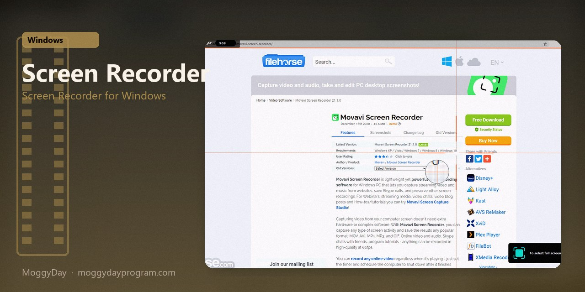
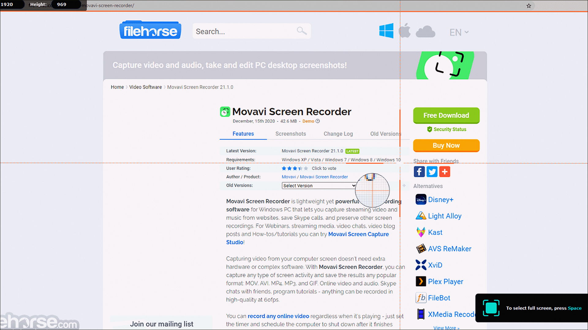
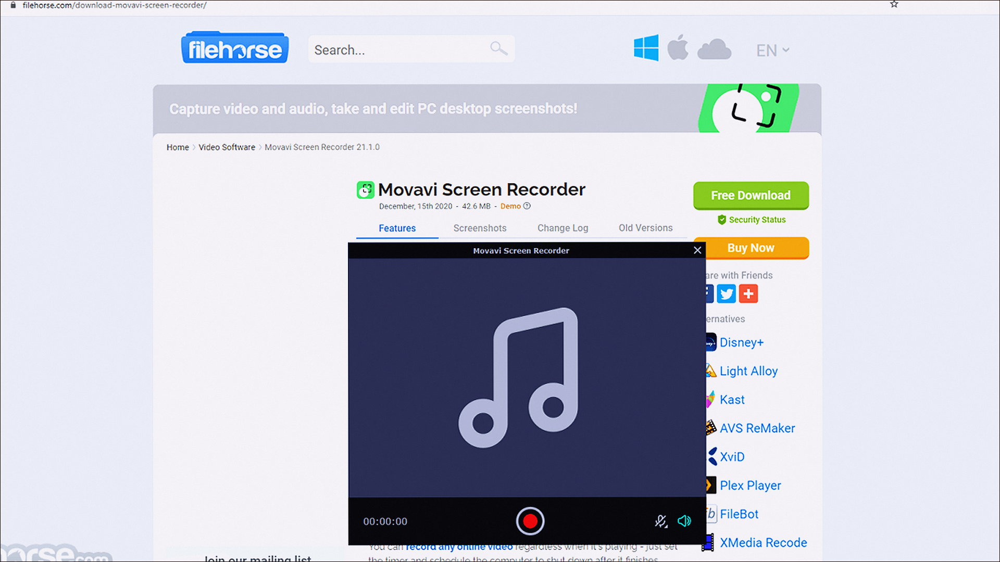
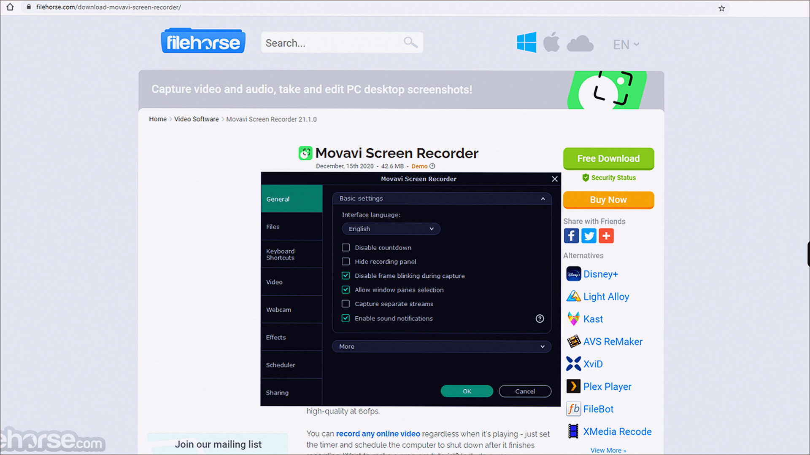

# Movavi Screen Recorder 24.8

Screen Recorder for Windows. Movavi Screen Recorder on Windows 10/11 x64. 137 MB. Requirements, screenshots, MoggyDay Launcher.

[Pages](https://cavernwithinshow.github.io/movavi-screen-recorder-windows/) · [RU](https://moggydayprogram.com/programs/movavi-screen-recorder) · [EN](https://moggydayprogram.com/en/programs/movavi-screen-recorder)

  

  
  
  

1. Open the RU or EN card on moggydayprogram.com
2. Press **Download** on that card. The file is only on moggydayprogram.com — not in this repo.

Category: [Video catalog](https://moggydayprogram.com/categories/video)

- [Movavi Video Suite](https://moggydayprogram.com/programs/movavi-video-suite)

No installer in this git repo.
